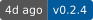
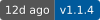
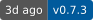
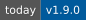
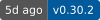
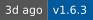
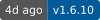
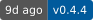
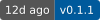

<samp>

Building software I use.

</samp>

## Maintaining projects

<!-- maintaining-projects:start -->
### Apps

| Project | Description | Badges |
| --- | --- | --- |
| [artefact](https://github.com/Delnegend/artefact) | Remove JPEG compression artefacts with a Rust rewrite of jpeg2png (native CLI + WebGPU/WASM in the browser) |    |
| [freshdesk](https://github.com/Delnegend/freshdesk) | Freshdesk API client and CLI in Rust: tickets, TOTP agent login, quarterly SLA reports |    |
| [differ](https://github.com/Delnegend/differ) | Diff sequences of near-identical images into a base plus tiny difference files |   |

### Services

| Project | Description | Badges |
| --- | --- | --- |
| [dpi-proxy](https://github.com/Delnegend/dpi-proxy) | An HTTP proxy for Linux and Windows that helps Steam and other applications bypass network traffic inspection. |   |
| [zero-g](https://github.com/Delnegend/zero-g) | OpenAI-compatible AI gateway for multiple providers. |    |
| [rsRPC](https://github.com/Delnegend/rsRPC) | Rust implementation of the Discord RPC server |    |
| [segotep-digital](https://github.com/Delnegend/segotep-digital) | Unofficial Segotep Digital software for Linux and Windows |   |
| [l4d2-server-container](https://github.com/Delnegend/l4d2-server-container) | Left 4 Dead 2 Linux dedicated server container with 8-player co-op support and instant boot times |    |
| [hath-server-container](https://github.com/Delnegend/hath-server-container) | Hentai@Home client in Docker with Java runtime, bind-mounted cache and credentials |   |
| [mikrotik-mcp-server](https://github.com/Delnegend/mikrotik-mcp-server) | MCP server for MikroTik RouterOS: fleet management, safe mode, and a full-config backup/restore CLI |   |

### Libraries

| Project | Description | Badges |
| --- | --- | --- |
| [axum-auth-gate](https://github.com/Delnegend/axum-auth-gate) | Basic and OIDC authentication middleware for Axum routers |    |

<!-- maintaining-projects:end -->
